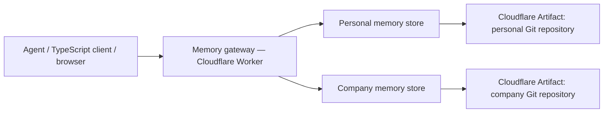

# OMP on Cloudflare — working prototype

A TypeScript implementation inside the OMPI fork. It follows the **minimal memory object / exchange profile** of the [October 14 editors' draft (PR #13)](https://github.com/The-AI-Disclosures-Project/Open-Memory-Protocol/pull/13) and implements concrete HTTP payloads for the FMP endpoint proposal. Neither upstream proposal is an adopted standard. This is an experimental implementation, not an official OMP SDK.

Live demo: https://ompi-memory.roundtrip.workers.dev

**Use it with Codex:** [installation and examples](codex/README.md). The deployed `/mcp` endpoint exposes six tools for recall, explicit personal/company writes, guarded revisions, and deletion. Run `npm run codex:setup` to register the server and install the checked-in memory skill.

## Architecture



**Every memory is durably stored in Cloudflare Artifacts**, in `omp-state.json` in a Git repository. `MEMORY.md` is a lightweight index. These are actual Cloudflare Artifacts, not process-local state, KV, D1, R2, or GitHub storage. `memfs` is only an ephemeral Git working tree used while committing; success is returned after the push succeeds. Reads fetch a specific commit through the Artifacts binding.

The connected repositories in namespace `ompi-memory-prototype` are:

- `personal`: personal preferences and context.
- `company`: company knowledge and decisions.

The gateway searches both in parallel and returns the source store for each result. If a store fails, it reports `partial: true` and per-store failures; if both fail, it returns 503. Writes carry `store: "personal" | "company"`. Omitted targets default to personal; an unknown target is rejected. The server does not guess that personal information belongs to a company. Stores are separate repositories, but **there is no access isolation** in this public prototype.

Runtime: Cloudflare Workers. Storage and revision history: Cloudflare Artifacts. No external runtime services or database. GitHub hosts implementation source only.

## Run and deploy

Requirements: Node.js 24.22.x or a compatible later 24.x release, or Node.js 26.12+, and a `cf` login authorized for Workers and Artifacts. `.node-version` selects 24.22.0; the lockfile pins CLI and build dependencies.

```sh
cd prototypes/cloudflare-memory
npm ci
cf auth whoami
npm run typecheck
npm test
npm run deploy
npm run roundtrip -- https://ompi-memory.roundtrip.workers.dev
```

`cloudflare.config.ts` targets the **Roundtrip** account explicitly. To deploy elsewhere, change `accountId` and create the namespace and the two repositories in that account:

```sh
cf artifacts namespaces create --namespace ompi-memory-prototype
cf artifacts namespaces repos create ompi-memory-prototype --name personal --default-branch main
cf artifacts namespaces repos create ompi-memory-prototype --name company --default-branch main
cf deploy
```

Repository creation outputs an initial Git token: keep it private. Runtime requests mint short-lived repo-scoped tokens through the binding and revoke them in `finally`; no token is sent to API clients or stored in source. `npm run dev` uses the CLI's local Artifacts simulation; deploy/roundtrip verifies the real service.

## TypeScript client

The source client is `sdk/client.ts`. It uses standard `fetch` and exports the draft memory and archive types. Import it directly in TypeScript; it has not been published to npm.

```ts
import { OmpClient, OmpGateway } from "./sdk/client.ts";

const url = "https://ompi-memory.roundtrip.workers.dev";
const gateway = new OmpGateway(url);

await gateway.remember(
  {
    identifier: "demo-preference", // Stable identity; read after an uncertain write before retrying.
    body: "The user prefers concise answers.",
    tags: ["preference"],
  },
  "personal",
);

await gateway.remember(
  {
    identifier: "demo-company-process",
    body: "Example company releases happen on Fridays.",
    tags: ["decision"],
  },
  "company",
);

const hits = await gateway.search("Friday");
// hits.memories: [{ store: 'company', memory: {...}, commit: '...' }]

const personal = new OmpClient(url, "personal");
const company = new OmpClient(url, "company");
const snapshot = await personal.export();
const receipt = await company.import(snapshot); // Explicit copy, never automatic sync.
console.log(receipt.receipts);
```

## HTTP API

`GET /fmp/info` advertises prototype capabilities and limitations. `GET /gateway/info` describes connected stores and routing.

| Method | Gateway endpoint                 | JSON body                                                                                                                    |
| ------ | -------------------------------- | ---------------------------------------------------------------------------------------------------------------------------- |
| POST   | `/gateway/fmp/search`            | `{ "query": "TypeScript", "limit": 20 }` — searches both stores                                                              |
| POST   | `/gateway/fmp/upload/inferences` | `{ "store": "personal", "memory": { "identifier": "note-1", "body": "Use TypeScript" } }`                                    |
| POST   | `/gateway/fmp/read`              | `{ "store": "company", "identifier": "note-1", "origin": "optional-origin" }`                                                |
| POST   | `/gateway/fmp/update`            | `{ "store": "personal", "identifier": "note-1", "if_version": "optional-token-from-read", "patch": { "body": "Use Rust" } }` |
| POST   | `/gateway/fmp/delete`            | `{ "store": "personal", "identifier": "note-1" }`                                                                            |
| POST   | `/gateway/fmp/import`            | An exported archive plus `"store": "company"`                                                                                |

Every store also exposes these endpoints directly at `/stores/{personal|company}/fmp/...` without the `store` field. Additional store endpoints:

| Method | Endpoint                             | Meaning                                               |
| ------ | ------------------------------------ | ----------------------------------------------------- |
| GET    | `/stores/:store/fmp/read_inferences` | Export snapshot, manifest, tombstones, storage commit |
| GET    | `/stores/:store/history`             | Latest 20 Artifacts Git commits                       |
| GET    | `/stores/:store/fmp/info`            | Store capabilities                                    |

`upload/inferences` supplies UUID identifier, `text/plain` media type, and current timestamp if absent. Imported memories must contain the draft's required fields (`identifier`, `media_type`, `created_at`, `body`). The body is text, including when its media type is JSON. Unknown fields survive storage and export/import. `read` retrieves by identifier with optional origin; ambiguous identifiers require origin. Search uses a case-insensitive substring over identifier, body, title, and tags, filtering future and expired memories. It is not semantic/vector search.

Example write response:

```json
{
  "routed_to": "personal",
  "memory": {
    "identifier": "note-1",
    "media_type": "text/plain",
    "created_at": "2026-11-06T12:00:00Z",
    "body": "Use TypeScript",
    "x_omp_origin": "cloudflare-artifacts:ompi-memory-prototype/personal"
  },
  "receipts": [
    {
      "identifier": "note-1",
      "origin": "cloudflare-artifacts:ompi-memory-prototype/personal",
      "status": "accepted"
    }
  ],
  "commit": "<40-character Git commit hash>"
}
```

The `x_omp_origin` extension preserves `(origin, identifier)` across multi-hop copies. Repeated imports return `unchanged` without duplicates. Different content with the same identity is `rejected` in the per-object receipt; imports never silently overwrite it. Local memories may be changed through `update`; imported memories are immutable here. Export/import supports the minimal profile and snapshot/copy only. Unknown profiles and move intents are rejected.

Deletion removes a memory from the current view and exports and records a content-free tombstone. Tombstones block stale imports of that identity and propagate to another store when its snapshot is explicitly imported. **Git history retains old content: deletion is not secure erasure, forget, or automatic revocation of other copies.** No audit-profile conformance is claimed.

Concurrent writes use Git fast-forward checks: a rejected push re-clones the current branch and reapplies the operation, up to four attempts. No force pushes. Reads return a per-memory `version` token; passing it as `if_version` to update/delete rejects stale edits with 409. MCP requires this guard, while existing REST callers may opt in. A storage failure returns 503; after an uncertain create, search/read before retrying because generated timestamps/identifiers do not guarantee idempotency. Request bodies are capped at 1 MiB, each memory body at 16 KiB, and each store at 100 memories / 500 tombstones / 512 KiB of current state. Git history continues growing. This is a small demo, not a high-throughput memory database.

## Verification

`npm test` checks field preservation, idempotency, origin collisions, conflict rejection, tombstone replay protection, field validation, routing, and temporal filtering. `npm run roundtrip -- URL` exercises the deployed gateway and both stores, cross-store copy and copy-back, unknown field preservation, repeated imports, local update, concurrent writes, deletion/replay, invalid input, and actual Git history. It removes its sample memories from current views afterward; their Git history and tombstones remain.

The saved [live verification report](verification/README.md) records the deployed version, Artifact repository IDs, and passing round-trip checks.

## Prototype boundaries

No authentication, authorization, scope policy, tenant separation, semantic search, transcript/file ingestion, automatic consolidation, secure forget, or full audit compliance. Runtime applicability/activation filtering is an experimental convention, not access control. Anyone who knows the demo URL can read and write both stores. Use sample data. The account and deployment names are intentionally committed; credentials are not.
