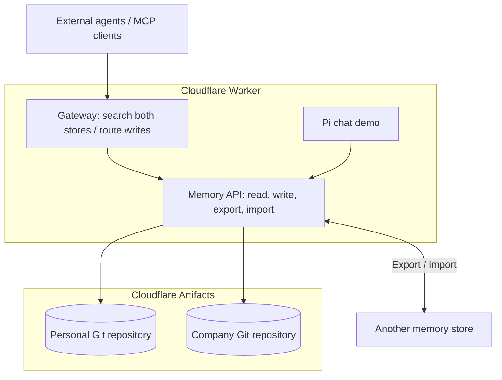

# OMP on Cloudflare

[Open Memory Protocol (OMP)](https://github.com/The-AI-Disclosures-Project/Open-Memory-Protocol) is an open protocol for moving and sharing AI-agent memory: saved facts, preferences, and context that can travel between agents and memory providers.

This example runs both an **OMP gateway** and the **memory stores** on Cloudflare Workers, with a [Pi chat agent](https://developers.cloudflare.com/agents/harnesses/pi/) to try them.

[](https://github.com/irvinebroque/omp-cloudflare/actions/workflows/ci.yml)



- **Gateway:** gives clients one entry point to search Personal and Company together and choose where to save memories. HTTP endpoints live under `/gateway`; MCP clients connect to `/mcp`.
- **Memory stores:** actually persist the records and serve reads, updates, deletions, and export/import under `/stores/personal` and `/stores/company`.
- **Chat demo:** saves and recalls memories through the selected store. A new chat starts a new transcript while keeping saved memories.

[Cloudflare Artifacts](https://developers.cloudflare.com/artifacts/) is managed, versioned storage with a Git-compatible interface. This example creates one Git repository per store in your Cloudflare account. Each holds an `omp-state.json` file containing memories and deletion markers; every mutation creates a Git commit. Deleting a memory removes it from current results but retains its Git history.

## Deploy

Requires [Workers Paid and Artifacts access](https://developers.cloudflare.com/artifacts/get-started/). AI usage is billed to your account.

1. Generate an access key and save it:

   ```sh
   openssl rand -hex 32
   ```

2. Click the button, choose your account and repository name, and enter the key as **MEMORY_API_TOKEN**.

   [](https://deploy.workers.cloudflare.com/?url=https://github.com/irvinebroque/omp-cloudflare)

3. Use Node **24.22+** (24.x), keep `npm run build` and `npm run deploy`, and disable **Preview builds**. The build token needs Workers Scripts and Artifacts write access.
4. Open your Worker URL. Select **Connect**, paste your access key, and connect.

To deploy from your checkout after `npm ci` and `npx cf auth login`:

```sh
export MEMORY_API_TOKEN=your-saved-key
npm run deploy
```

### Access key

Use the value saved as `MEMORY_API_TOKEN`. If someone shared their demo, ask them for its key. To replace a lost key, generate a new one and redeploy with it set. The key unlocks chat and both stores; keep it private. The browser forgets it on refresh. Cloudflare API tokens are separate deployment credentials.

## Run locally

Use Node **24.22+** (24.x) and a Cloudflare account.

```sh
git clone https://github.com/irvinebroque/omp-cloudflare.git
cd omp-cloudflare
npm ci
npx cf auth login
OMP_REMOTE_AI=true npm run dev
```

Open **http://localhost:5173** and select **Connect**. The development access key is filled in for you. Local chat uses your account’s Workers AI. Set `CLOUDFLARE_ACCOUNT_ID` to choose an account explicitly.

## Try it

1. Ask: **“Remember that I prefer concise TypeScript examples.”**
2. Select **New chat**.
3. Ask: **“What response style do I prefer?”**

To transfer memories, **Export** under **Memories**, connect to the other store, then **Import** the file.

## More

- [Contributing and checks](CONTRIBUTING.md)

Independent community example of the OMP v0.5 editors’ draft. Experimental routes are not adopted OMP standards. Apache-2.0.
