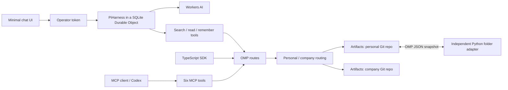
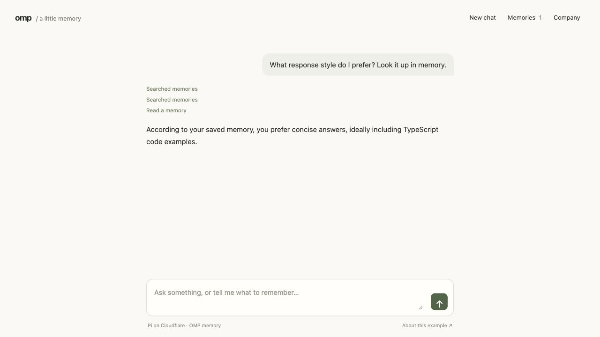

# OMP on Cloudflare

A minimal chat agent with memory you can take with you. [Cloudflare’s Pi harness](https://developers.cloudflare.com/agents/harnesses/pi/) runs the conversation in a Durable Object, uses Workers AI, and saves reusable context through OMP in Cloudflare Artifacts. Start a fresh chat and the agent can recall what you asked it to remember. The same memories are available over HTTP, MCP, and portable JSON snapshots.

[](https://github.com/irvinebroque/omp-cloudflare/actions/workflows/ci.yml)
[](https://deploy.workers.cloudflare.com/?url=https://github.com/irvinebroque/omp-cloudflare)

This is an independently maintained **community implementation example** of the [Open Memory Protocol editors’ draft v0.5](https://github.com/The-AI-Disclosures-Project/Open-Memory-Protocol/blob/main/working-group/exchange-and-runtime/2026-11-06-working-spec-v0.5.md). The HTTP routes, MCP tools, archive envelope, and runtime conventions here are experimental. The OMP project has not designated this an official reference implementation. See [protocol coverage](docs/protocol.md).



<details>
<summary>Browser demo: a conversation with portable memory</summary>



</details>

## Run locally

You need Node **24.22+** within the 24.x line (or 26.12+ within 26.x), npm, and Python 3.10+ for the independent exchange test. Memory storage and the automated protocol suite run entirely locally without credentials. **Chat uses real Workers AI inference** and requires Cloudflare authentication; inference is billed to your account.

```sh
git clone https://github.com/irvinebroque/omp-cloudflare.git
cd omp-cloudflare
npm ci
npm run dev
```

Open **http://localhost:5173**. **Connect** holds the operator token and store selector; the development token is filled in automatically. **Memories** shows saved facts and snapshot import/export. Without remote AI enabled, local chat is disabled while the memory APIs and transfer controls remain available.

To use the local chat UI, stop the server, sign in, and opt in to Workers AI:

```sh
npx cf auth login
# Select your account if you have more than one:
export CLOUDFLARE_ACCOUNT_ID=your-account-id
OMP_REMOTE_AI=true npm run dev
```

1. Connect, then ask: **“Remember that I prefer concise TypeScript examples.”**
2. Select **New chat**.
3. Ask: **“What response style do I prefer?”** The agent searches and reads the OMP store in the new conversation.
4. Open **Memories**, export a snapshot, switch to the other store in **Connect**, and import it. A new chat in that store can retrieve the imported context.

Chat history lives in Pi’s SQLite tables. Only facts explicitly saved with the `remember` tool become portable OMP memories. The browser polls Pi’s live view while a run is active, showing partial answers and tool receipts. Reloading keeps the conversation ID in tab session storage; the token must be entered again. [Agent architecture, API, privacy, and limits](docs/agent.md).

The Artifacts binding runs in a **local simulator**, persists under `.cloudflare/state`, and initializes its repositories on first use. Local development never binds to your deployed Artifacts namespace. Removing `.cloudflare/state` resets local data after you stop the server.

Try the API:

```sh
export OMP_API_TOKEN=local-development-token-only
export OMP_URL=http://localhost:5173

curl "$OMP_URL/gateway/fmp/upload/inferences" \
  -H "Authorization: Bearer $OMP_API_TOKEN" \
  -H 'Content-Type: application/json' \
  -d '{"store":"personal","memory":{"identifier":"answer-style","body":"Prefer concise answers with working code.","media_type":"text/markdown","protocol_version":"0.5"}}'

curl "$OMP_URL/gateway/fmp/search" \
  -H "Authorization: Bearer $OMP_API_TOKEN" \
  -H 'Content-Type: application/json' \
  -d '{"query":"concise"}'
```

## Deploy to your Cloudflare account

Deployment requires [Workers Paid and Artifacts access](https://developers.cloudflare.com/artifacts/get-started/). Review [Artifacts pricing](https://developers.cloudflare.com/artifacts/platform/pricing/). The service uses one private operator token; `personal` and `company` are separate stores under that operator, not separate tenants.

### Deploy button

Click **Deploy to Cloudflare** above. Cloudflare copies this template into your GitHub account and configures Workers Builds.

1. Select your Cloudflare account and repository name.
2. Generate a private token with `openssl rand -hex 32`. Enter it as **MEMORY_API_TOKEN** when prompted. Keep the value for your browser and clients.
3. Keep the detected build command, `npm run build`, and deploy command, `npm run deploy`. Disable **Preview builds** for this example; its validated path is a production Worker. Use Node 24.22+ in build settings.
4. Ensure the build’s Cloudflare API token can edit **Workers Scripts** and **Artifacts** in the selected account. The deploy script inspects or creates the Artifacts namespace matching the copied project’s name with `cf`, then deploys the Worker, SQLite Durable Object, Workers AI binding, and assets. The build credentials must allow deploying the Durable Object and Workers AI bindings as well.
5. Open the resulting Worker URL, enter your operator token, and select **Connect**. Both repositories initialize on first use.

`wrangler.jsonc` supplies the metadata the button discovers. `cloudflare.config.ts` is the configuration used by `cf`. `cf` reads the project name and compatibility date from that metadata, including changes made by the deploy button. The default namespace follows the copied project’s name. Artifacts is not in the button’s [automatic resource list](https://developers.cloudflare.com/workers/platform/deploy-buttons/); provisioning is handled by our deploy script. See [deployment details and troubleshooting](docs/deployment.md).

### Deploy with the Cloudflare CLI

Use the checked-in `cf` version through npm scripts:

```sh
npx cf auth login
# If you have multiple accounts, choose explicitly:
export CLOUDFLARE_ACCOUNT_ID=your-account-id

# Save this private value securely. Do not commit it.
export MEMORY_API_TOKEN="$(openssl rand -hex 32)"
npm run deploy

# Use the URL printed by cf:
export OMP_URL=https://your-worker.your-subdomain.workers.dev
export OMP_API_TOKEN="$MEMORY_API_TOKEN"
npm run roundtrip -- "$OMP_URL"
npm run mcp:roundtrip -- "$OMP_URL"
```

To create another deployment, set **both** `OMP_WORKER_NAME` and `OMP_NAMESPACE` to new names. Reusing a namespace intentionally shares its stores. Secrets are uploaded from a temporary mode-0600 JSON file and removed after deployment. When no `MEMORY_API_TOKEN` environment variable is supplied, deployment preserves an existing Worker secret; a new Worker without a secret rejects protected operations.

## Use the TypeScript SDK

The SDK is source in this repository, not a published npm package. Run examples with `npx vpx` or use it from your checkout on supported Node.js.

```ts
import { OmpClient, OmpGateway } from "./sdk/client.ts";

const url = process.env.OMP_URL ?? "http://localhost:5173";
const token = process.env.OMP_API_TOKEN ?? "local-development-token-only";
const gateway = new OmpGateway(url, token);
const personal = new OmpClient(url, "personal", token);
const company = new OmpClient(url, "company", token);

const saved = await gateway.remember({
  identifier: crypto.randomUUID(),
  body: "Use TypeScript for examples.",
  custom_metadata: { preserve_me: true },
});
const current = await personal.read(saved.memory.identifier);
await personal.update(
  current.memory.identifier,
  { body: "Use TypeScript with strict checks." },
  current.memory.x_omp_origin,
  current.version,
);

// snapshot() collects every tombstone page; importSnapshot() sends bounded requests.
const snapshot = await personal.snapshot();
const received = await company.importSnapshot(snapshot);
console.log(received.receipts); // accepted, unchanged, or rejected for each memory
```

Always inspect import receipts. Conflicting content at an existing identity is rejected; a repeated identical copy is unchanged. Imported memories retain their origin and are immutable here. To revise one, author a new local memory. Updates and deletes accept `if_version`; MCP requires it. On a 409, read again and reconcile.

## Connect an MCP client or Codex

The MCP endpoint is **`<your-worker-url>/mcp`**, using Streamable HTTP and `Authorization: Bearer <your-token>`.

| Tool              | Purpose                                                      |
| ----------------- | ------------------------------------------------------------ |
| `about_omp`       | Discover capabilities, limits, and experimental conventions  |
| `search_memories` | Search applicable summaries across both stores               |
| `get_memory`      | Retrieve the complete memory, provenance, and version        |
| `add_memory`      | Create a memory in an explicit store                         |
| `update_memory`   | Revise local content using the version just read             |
| `delete_memory`   | Remove current content and write a replay-blocking tombstone |

For Codex, export `OMP_API_TOKEN` in the environment that starts Codex, then:

```sh
npm run codex:setup -- "$OMP_URL/mcp"
# Start a fresh Codex session and ask:
# Use $omp-memory to remember that I prefer concise TypeScript examples.
# In another fresh session:
# Use $omp-memory to recall my response preferences.
```

Setup adds one MCP entry and links this checkout’s memory skill under `~/.agents/skills/omp-memory`. Keep the checkout in place. It refuses to replace an existing entry with another URL or an unrelated skill. See [Codex setup, manual config, and verification](codex/README.md).

## See an independent receiver

The [Python folder adapter](examples/file-store.py) uses only the standard library. It reads the minimal fields, writes each exported memory into its own JSON file, and preserves the remaining envelope and metadata without importing this implementation’s TypeScript or interpreting its private identity map.

```sh
curl "$OMP_URL/stores/personal/fmp/read_inferences" \
  -H "Authorization: Bearer $OMP_API_TOKEN" > snapshot.json
python3 examples/file-store.py import snapshot.json memory-folder
python3 examples/file-store.py export memory-folder returned.json
```

The curl example fetches one page. For stores with more than 50 tombstones, use `OmpClient.snapshot()` to collect the full snapshot. The adapter refuses to overwrite an existing folder. [Exchange behavior and collision handling](docs/protocol.md) explain the boundary this demonstrates.

## Develop and verify

This project uses **Vite+ 1.5** for Vite/Rolldown builds, Vitest, Oxfmt, Oxlint, type-aware linting, and script execution. `cf dev` and `cf build` delegate to Vite+. Configuration lives in `vite.config.ts`.

```sh
npm run verify       # strict checks + unit tests + production build + isolated local E2E
npm run test:quality # verifies the registered anti-slop plugin accepts/rejects fixtures
npm run format       # Oxfmt
npm run check        # formatting, Oxlint, and strict TypeScript; warnings fail
```

All generic rules from [Dillon Mulroy’s anti-slop](https://github.com/dmmulroy/anti-slop) are enabled as errors, alongside unsafe-assignment/call/return checks, strict booleans, promise checks, and exhaustive switches. Its [installation/update skill](.agents/skills/install-anti-slop/SKILL.md) is checked in at the same pinned revision as the vendored rules. [Provenance and the Vite+ import adaptation](tools/oxlint/anti-slop/UPSTREAM.md) record the only local vendor change. No lint suppressions or application type assertions are needed.

The E2E suite starts fresh local simulators, restarts a server to prove persistence, tests an independent deployment’s origin, exchanges through Python, and exercises HTTP/MCP concurrency, import replay, pagination, and stale-version rejection. GitHub Actions runs the same suite without Cloudflare credentials. [Validation record](docs/validation.md) separates local, live, browser, and model checks.

```text
src/agent/       Pi harness, replay-safe OMP tools, typed browser chat contract
src/protocol/    Memory validation, exchange, pagination, and local runtime conventions
src/storage/     Artifacts repositories, Git commits, optimistic retries, token cleanup
src/server/      HTTP routes, gateway, bearer authentication, MCP tools
src/web/         Vite-built browser demo with its own DOM TypeScript configuration
sdk/             Validated TypeScript HTTP clients
examples/        Independent Python snapshot receiver/exporter
scripts/         Deploy, setup, and end-to-end verification
codex/           Optional MCP configuration and memory skill
tests/           Unit and integration test contracts
```

## Boundaries

This is a small, inspectable example: 100 active memories and 512 KiB of active JSON per store, 16 KiB per body, and 1 MiB per API request. Search is substring matching. Bodies are UTF-8 strings with valid MIME labels; binary transport is unsupported. Git history and tombstones grow over time.

The operator token controls all memory routes, including MCP and history. Discovery and static UI assets are public. Repository applicability controls retrieval, not authorization. Provenance is self-declared. Pi transcripts persist separately in Durable Objects and are not part of an OMP snapshot. New chat does not delete previous transcripts. Pi Durable is experimental and does not provide conversation deletion through this demo. Deleted memory content remains in Git history; this does not implement secure forgetting, multi-user authorization, autonomous memory hooks, vector search, realtime sync, move semantics, or full OMP profile conformance.

Apache-2.0. Extracted from the original Cloudflare prototype with its Git history preserved. [Maintenance and possible OMP adoption](docs/ownership.md).
