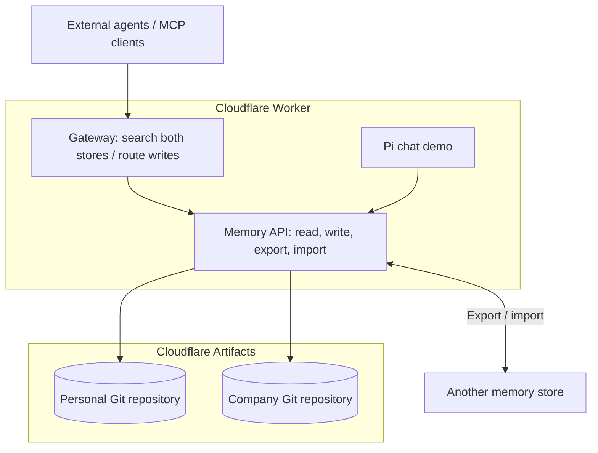

# OMP on Cloudflare

[Open Memory Protocol (OMP)](https://github.com/The-AI-Disclosures-Project/Open-Memory-Protocol) is an open protocol for moving and sharing AI-agent memory: saved facts, preferences, and context that can travel between agents and memory providers.

This example runs both an **OMP gateway** and the **memory stores** on Cloudflare Workers, with a [Pi chat agent](https://developers.cloudflare.com/agents/harnesses/pi/) to try them. It targets the v0.5 draft's minimal profile. See [protocol coverage and conventions](CONFORMANCE.md) for supported behavior, exchange requirements and limitations.

**Clone your memory, inspect its history, and use it across agents.** Memories live in Git repositories in your Cloudflare account, with MCP access and OMP export/import.

[](https://github.com/irvinebroque/omp-cloudflare/actions/workflows/ci.yml)



- **Gateway:** gives clients one entry point to search Personal and Company together and choose where to save memories. HTTP endpoints live under `/gateway`; MCP clients connect to `/mcp`.
- **Memory stores:** actually persist the records and serve reads, updates, deletions, and export/import under `/stores/personal` and `/stores/company`.
- **Chat demo:** saves and recalls memories through the selected store. A new chat starts a new transcript while keeping saved memories.

[Cloudflare Artifacts](https://developers.cloudflare.com/artifacts/) is managed, versioned storage with a Git-compatible interface. This example creates one Git repository per store in your Cloudflare account. Each holds an `omp-state.json` file containing memories and deletion markers; every mutation creates a Git commit. Deleting a memory removes it from current results but retains its Git history.

## Deploy

Requires [Workers Paid and Artifacts access](https://developers.cloudflare.com/artifacts/get-started/). AI usage is billed to your account.

1. Generate an access key and save it:

   ```sh
   openssl rand -hex 32
   ```

2. Click the button, choose your account and repository name, and enter the key as **MEMORY_API_TOKEN**.

   [](https://deploy.workers.cloudflare.com/?url=https://github.com/irvinebroque/omp-cloudflare)

3. Use Node **24.22+** (24.x), use `pnpm build` and `pnpm run deploy` from the repository root, and disable **Preview builds**. Set the install command to `pnpm install --frozen-lockfile`. The build token needs Workers Scripts and Artifacts write access.
4. Open your Worker URL. Select **Connect**, paste your access key, and connect.

To deploy from your checkout after `pnpm install --frozen-lockfile` and `pnpm --filter omp-cloudflare exec cf auth login`:

```sh
export MEMORY_API_TOKEN=your-saved-key
pnpm run deploy
```

### Access key

Use the value saved as `MEMORY_API_TOKEN`. If someone shared their demo, ask them for its key. To replace a lost key, generate a new one and redeploy with it set. The key unlocks chat and both stores; keep it private. The browser forgets it on refresh. Cloudflare API tokens are separate deployment credentials.

## Run locally

Use Node **24.22+** (24.x) and a Cloudflare account.

```sh
git clone https://github.com/irvinebroque/omp-cloudflare.git
cd omp-cloudflare
pnpm install --frozen-lockfile
pnpm --filter omp-cloudflare exec cf auth login
OMP_REMOTE_AI=true pnpm dev
```

Open **http://localhost:5173** and select **Connect**. The development access key is filled in for you. Local chat uses your account’s Workers AI. Set `CLOUDFLARE_ACCOUNT_ID` to choose an account explicitly.

## Try it

1. Ask: **“Remember that I prefer concise TypeScript examples.”**
2. Select **New chat**.
3. Ask: **“What response style do I prefer?”**

### Clone your memory

After saving a memory in your deployed demo, clone its Artifacts repository with a short-lived read token. From this checkout, with Git, [jq](https://jqlang.org/) and `cf` signed in to your Cloudflare account:

```sh
# Use your deployed namespace, normally the project name. Use company for the other store.
OMP_NAMESPACE=omp-cloudflare
OMP_STORE=personal

ARTIFACTS_REMOTE=$(
  pnpm --filter omp-cloudflare exec cf artifacts namespaces repos get "$OMP_STORE" \
    --namespace "$OMP_NAMESPACE" | jq -er '(.result // .).remote'
)
ARTIFACTS_TOKEN=$(
  pnpm --filter omp-cloudflare exec cf artifacts namespaces tokens create "$OMP_NAMESPACE" \
    --repo "$OMP_STORE" --scope read --ttl 3600 | jq -er '(.result // .).plaintext'
)

git -c http.extraHeader="Authorization: Bearer $ARTIFACTS_TOKEN" \
  clone "$ARTIFACTS_REMOTE" my-memory
git -C my-memory log --oneline
git -C my-memory show HEAD -- omp-state.json
```

Open `my-memory/omp-state.json` for full records and provenance, or `my-memory/MEMORY.md` for an index. Save another memory through the agent, then inspect the change:

```sh
git -C my-memory -c http.extraHeader="Authorization: Bearer $ARTIFACTS_TOKEN" fetch origin
git -C my-memory diff HEAD..origin/main -- omp-state.json
```

The repo token expires after one hour and is separate from the demo's access key. This follows [Artifacts' Git authentication flow](https://developers.cloudflare.com/artifacts/examples/git-client/), keeping the token out of the saved remote URL. The checkout contains this app's storage format and Git history, including deleted memories; use OMP export for interchange.

### Use the same memory from another agent

Connect an MCP-capable agent to `https://<your-worker>/mcp` using `Authorization: Bearer <your-access-key>`. Ask it to recall the preference you saved in chat: `search_memories` finds matching records, and `get_memory` retrieves their full content and provenance. The gateway searches Personal and Company together and lets the agent choose a store for writes. Memory use depends on the agent calling the tools.

### Move memories or build your own client

Select **Export** under **Memories**, connect to another store or deployment, then **Import** the file. The copy preserves original identity, provenance and custom metadata; repeated imports are idempotent. Export includes deletion markers to prevent stale copies from resurrecting deleted records.

The [TypeScript SDK](packages/omp-sdk) provides portable validation, experimental exchange helpers and this server's HTTP client. Use it independently of the chat UI to build another client or memory integration.

## Workspace

This pnpm monorepo contains two packages:

- [`packages/omp-sdk`](packages/omp-sdk): `@omp-cloudflare/sdk`, with portable types and validation, experimental exchange/reference helpers, the example's HTTP binding, and shared test fixtures. It builds ESM JavaScript and TypeScript declarations.
- [`apps/cloudflare`](apps/cloudflare): the Worker, Artifacts storage, MCP server and Pi chat demo. It consumes the SDK through `workspace:*`.

Use the pinned pnpm version in `package.json` (install it with `corepack enable` if needed). Root commands build the SDK before starting or building the app. The SDK is built locally; this does not publish it to a registry.

## More

- [Contributing and checks](CONTRIBUTING.md)

Independent community example of the OMP v0.5 editors’ draft. Experimental routes are not adopted OMP standards. Apache-2.0.
