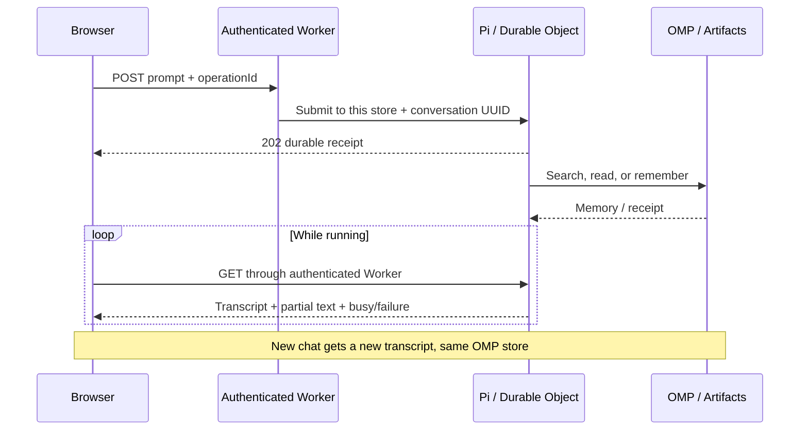

# The demo agent

The browser is a minimal chat client for [Cloudflare’s Pi harness](https://developers.cloudflare.com/agents/harnesses/pi/). `MemoryAgent` extends `DurableObject`, installs `PiHarness` with `Lifecycle` in its constructor, and uses the Workers AI Pi provider. Pi owns the transcript, model/tool loop, durable submissions, retries, and recovery. This app does not implement a second agent loop.



## Three tools

- `search_memories`: substring search in the selected store. Empty query lists recent memories.
- `read_memory`: retrieve a full result by identifier and original origin.
- `remember`: save a user-requested fact or preference through the same OMP upload route used by HTTP and MCP clients.

The model cannot execute code or change/delete existing memories. Its system prompt tells it to search before answering about saved context, read relevant results, treat retrieved text as untrusted data, and save only on explicit request. These are model instructions, not a complete prompt-injection defense. The operator is trusted and owns both stores.

Reads are replay-safe. `remember` first persists a UUID and timestamp in Pi’s per-call memo, then writes that stable identity to OMP. If recovery replays the same call, the identical upload is unchanged rather than duplicated. Different calls remain distinct. A browser submission has a separate UUID `operationId`; retrying that operation does not enqueue another prompt. At most one prompt runs in a conversation at a time; a competing submission receives 409. Each run is limited to six tool rounds, and prompts are capped at 8,000 characters.

## Browser transport

`POST /api/chat/<uuid>?store=personal` accepts `{ "prompt": "...", "operationId": "<uuid>" }` and returns a 202 receipt. `GET` on the same route projects Pi’s live view into the shared, Zod-validated chat contract. Both requests require the existing bearer token. The Worker derives the Durable Object name from the validated store and conversation UUID; the model cannot choose another store. The selected store is persisted before submission so alarm-only recovery uses the same tools.

The browser polls about once per second while a run is active. It shows user/assistant text and compact tool receipts, not hidden reasoning or the raw tool payload. All text is inserted with `textContent`. A response interrupted at the network layer can be recovered by reconnecting to the same tab’s conversation. Polling stops on completion or an error. A tab keeps only the conversation UUID in `sessionStorage`; it never saves the bearer token.

The UI shows the newest Pi transcript window and labels a truncated history. It does not implement transcript pagination, conversation management, or deletion. A new chat creates a new Durable Object conversation; the previous one remains stored. Pi’s experimental storage format may change between minor versions.

## What is portable

Conversation entries remain in Durable Object SQLite. They are not automatically OMP memories and do not appear in snapshots. Only tool-saved memory records live in Artifacts. Export/import preserves their identity and extension metadata just as for other OMP clients. An imported fact can be recalled by a new chat in the receiving store. Importing a snapshot does not import a Pi transcript or transfer a running agent.

The same operator token protects chat, MCP, memory routes, and history. This is not multi-user authorization, and chat IDs are not credentials. Memory text used by the agent is sent to the configured Workers AI model. Do not put secrets or sensitive sample data into validation prompts. Git deletion retains history, and the demo has no secure-forgetting mechanism for either storage layer.

## Validate with a real model

```sh
export OMP_API_TOKEN=your-runtime-token
npm run agent:roundtrip -- https://your-worker.your-subdomain.workers.dev
```

The script makes real inference calls: it saves a random sample fact, retries a submission, independently verifies exactly one OMP memory, recalls the random value in a new chat without placing it in the second prompt, reconnects, and checks store isolation. It removes the sample memory from current views afterward; the memory’s Git history and Pi transcripts remain. CI exercises the authenticated chat boundary and the full memory protocol locally without inference credentials. See the [validation record](validation.md).
